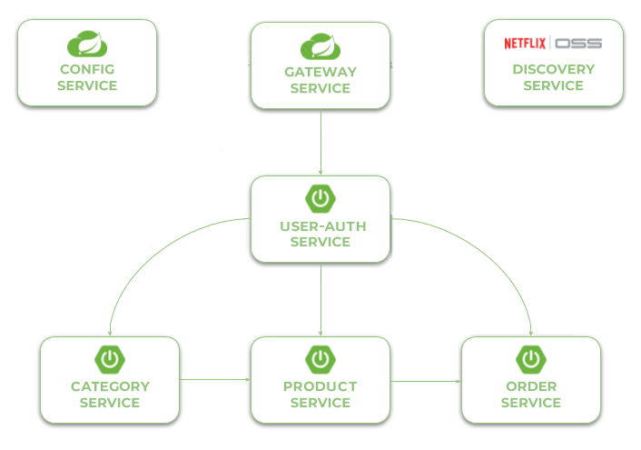

# Microservices with Spring Cloud Advanced Demo Project

### Requirements:

+ jdk 17 (or higher)
+ maven 3.9.14 (or higher)

### Api Documentation (Swagger)

* http://localhost:8080/swagger-ui.html (local host)

### Architecture

Our sample microservices-based system consists of the following modules:

- **gateway-service** - a module that Spring Cloud Gateway for running Spring Boot application that acts as a
  proxy/gateway in our architecture.
- **config-service** - a module that uses Spring Cloud Config Server for running configuration server in the `native`
  mode. The configuration files are placed on the classpath.
- **discovery-service** - a module that depending on the example it uses Spring Cloud Netflix Eureka or Spring Cloud
  Netlix Alibaba Nacos as an embedded discovery server.
- **user-auth-service** - a module providing authentication and authorization using JWT-token and registration used
  social networks (Google, Facebook, Linkedin, Github)
- **category-service** - a module containing the first of our sample microservices that allows to perform CRUD operation
  on in-memory repository of categories
- **product-service** - a module containing the second of our sample microservices that allows to perform CRUD
  operation on in-memory repository of product. It communicates with category-service.
- **order-service** - a module containing the third of our sample microservices that allows to perform CRUD
  operation on in-memory repository of order. It communicates with both product-service.

The following picture illustrates the architecture described above.

 
